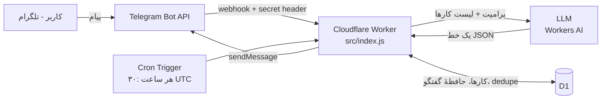

🇬🇧 [English](README.md) · 🇮🇷 فارسی

# hermes-mini ☿

ربات تلگرامِ **بدون سرور** برای مدیریت کارهای روزانه، با متن آزاد فارسی.
پروژهٔ درس رایانش ابری — همه‌چیز روی پلن رایگان Cloudflare اجرا می‌شود.

```
بخر شیر                → کار جدید ساخته می‌شود
شیر رو خریدم           → کار انجام‌شده علامت می‌خورد
چیه کارام؟             → لیست کارها
حذف شماره ۲            → حذف
سلام                   → پاسخ گفت‌وگویی
```

هیچ دستور اسلشی (`/start` و …) وجود ندارد؛ فهمیدن پیام و انتخاب عمل، کارِ مدل زبانی است.

## معماری در یک نگاه



جزئیات و توجیه تصمیم‌ها: [`docs/ARCHITECTURE.md`](docs/ARCHITECTURE.md)

## ساختار پروژه

```
src/index.js              ← کل منطق (یک فایل Worker)
migrations/0001_init.sql  ← جدول‌ها، جدا از کد
wrangler.toml             ← تنظیمات deploy (بدون هیچ secret)
test/                     ← تست واحد (npm test)
dev/                      ← ابزار تست محلی: mock تلگرام/LLM + e2e
scripts/                  ← set-webhook، webhook-info، check-secrets
docs/                     ← راهنما، معماری، گزارش، دفاع، Bale، دردسرهای رایج
CLAUDE.md, .claude/       ← زمینهٔ کار با هارنس هوش مصنوعی (Claude Code) و skill
```

## شروع سریع

راهنمای کامل و قدم‌به‌قدم (با مشخص‌کردن کارهایی که فقط خودت می‌توانی بکنی): **[`docs/GUIDE.md`](docs/GUIDE.md)**

```bash
npm install
npm test                 # تست واحد
npm run mock &           # تلگرام و LLM تقلبی
npm run host &           # اجرای همین Worker روی Node با دیتابیس موقت
npm run e2e              # ۲۰ بررسی سرتاسری
```

## نگاشت نیازمندی‌ها به کد

| نیازمندی | کجا |
|---|---|
| R1 فقط متن آزاد فارسی | هیچ handler دستوری وجود ندارد؛ `processUpdate` همه چیز را به LLM می‌دهد |
| R2 یک عمل از مجموعهٔ ثابت | `ACTIONS` و `execute()` در `src/index.js` |
| R3 JSON ساخت‌یافته + اعتبارسنجی + مسیر امن | `parseAction()`، یک تلاش مجدد، سپس `MSG.fallback`؛ هیچ چیزی در DB نوشته نمی‌شود |
| R4 حافظهٔ گفتگو | جدول `messages`، آخرین ۶ پیام در پرامپت |
| R5 فقط یک کاربر | `ALLOWED_USER_ID` (secret)، رد بی‌صدا |
| R6 webhook با secret | هدر `X-Telegram-Bot-Api-Secret-Token`، مقایسهٔ زمان‌ثابت، در غیر این صورت ۴۰۳ |
| R7 ذخیره در D1 + migration جدا | `migrations/0001_init.sql` |
| R8 فقط پلن رایگان | Workers + D1 + Workers AI؛ جدول محدودیت‌ها در `docs/ARCHITECTURE.md` |
| امتیاز: یادآور صبحگاهی | `scheduled()` + Cron Trigger |

## امنیت

هیچ secret ای در ریپو نیست و نباید باشد. `BOT_TOKEN`، `WEBHOOK_SECRET`، `ALLOWED_USER_ID` (و در صورت استفاده `LLM_API_KEY`) فقط با
`npx wrangler secret put` در secret store کلادفلر ذخیره می‌شوند. قبل از هر push این را اجرا کن:

```bash
bash scripts/check-secrets.sh
```

اگر توکنی به ریپو رفت: نمرهٔ بخش عملیات صفر می‌شود و **باید** توکن را در BotFather با `/revoke` باطل کنی.
