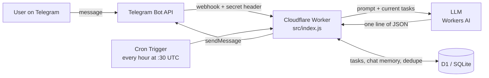

🇬🇧 English · 🇮🇷 [فارسی](README.fa.md)

# hermes-mini ☿

A **serverless Telegram bot** that manages your daily tasks from plain, free-form **Persian** text — no slash commands, no menus. A language model reads each message and picks exactly one action; everything runs on the **Cloudflare free plan** (Workers + D1 + Workers AI).

Built for the Cloud Computing course. Live instance: <https://hermes-mini.shadi-hermes.workers.dev> (`/health` returns a JSON status).

## What it does

| You write (Persian) | Meaning | Bot action |
|---|---|---|
| `بخر شیر` | "buy milk" | Adds a task |
| `شیر رو خریدم` | "I bought the milk" | Marks the task done |
| `چیه کارام؟` | "what are my tasks?" | Lists tasks |
| `شماره ۲ رو حذف کن` | "delete number 2" | Deletes a task |
| `همه رو حذف کن` | "delete all" | Deletes all tasks |
| `سلام` | "hello" | Friendly chat reply |
| `فردا ساعت ۹ به مادرم زنگ بزنم` | "call my mother tomorrow at 9" | Adds a task with a reminder |
| `برگردون` | "undo" | Reverts the last change |
| 🎙 a voice note | | Transcribed with Whisper, then handled like text |

Plus a **daily morning reminder** at 08:00 Tehran time and **per-task reminders** (date and optional hour, hourly Cron Trigger). Details: [`docs/FEATURES.md`](docs/FEATURES.md) (Persian).

## How it works



1. Telegram calls the Worker's webhook; the `X-Telegram-Bot-Api-Secret-Token` header is checked (wrong or missing → `403`).
2. Only the single whitelisted user ID is served; anyone else is silently ignored.
3. The Worker answers `200` immediately and does the real work in `ctx.waitUntil`, so Telegram never retries.
4. The model receives the message, the last 6 chat turns, the current task list and a 30-day calendar table, and must return one JSON action: `add | done | undone | del | list | remind | undo | chat`. Voice notes are first transcribed with Whisper (Workers AI).
5. `parseAction()` validates the JSON (fixed action set, bounded sizes, integer ids). Invalid output → one retry → a safe fallback message, and **nothing is written to the database**.
6. Duplicate Telegram deliveries are dropped via the `processed_updates` table.

More detail and the reasoning behind each decision: [`docs/ARCHITECTURE.md`](docs/ARCHITECTURE.md) (Persian).

## Tech stack

- **Cloudflare Workers** — a single-file Worker (`src/index.js`), no framework
- **Cloudflare D1** — tasks, conversation memory, processed update IDs; schema kept in `migrations/`
- **Workers AI** — `@cf/google/gemma-4-26b-a4b-it` (reasoning disabled for fast, clean JSON)
- **Cron Triggers** — daily reminder
- **Wrangler 4** for deployment; **Node's built-in test runner** for tests

## Project structure

```
src/index.js              the whole Worker (webhook, LLM call, actions, cron)
migrations/               0001 tables; 0002 due dates + undo journal
wrangler.toml             deployment config (contains no secrets)
test/                     unit tests (npm test)
dev/                      local mock Telegram/LLM servers + end-to-end checks
scripts/                  set-webhook, webhook-info, check-secrets
docs/                     guide, architecture, pitfalls, report (Persian)
CLAUDE.md, .claude/       context and skill for the AI coding harness
```

## Getting started

You need Node.js 20+, a free Cloudflare account, a Telegram bot token from [@BotFather](https://t.me/BotFather), and your numeric Telegram user ID. The full step-by-step walkthrough (Persian) is in [`docs/GUIDE.md`](docs/GUIDE.md); the short version:

```bash
npm install
npx wrangler login
npx wrangler d1 create hermes-mini-db        # copy the database_id into wrangler.toml
npm run db:migrate:remote                    # applies migrations/0001 and 0002

npx wrangler secret put BOT_TOKEN
npx wrangler secret put WEBHOOK_SECRET       # any long random string
npx wrangler secret put ALLOWED_USER_ID      # your numeric Telegram ID

npm run deploy
bash scripts/set-webhook.sh                  # points Telegram at your Worker
```

**Windows / PowerShell notes**

- Use `curl.exe`, not `curl` (which is an alias for `Invoke-WebRequest`).
- Telegram and `workers.dev` are filtered in some regions. With a VPN, pass its local proxy explicitly, e.g. `curl.exe --proxy http://127.0.0.1:<port> ...`.
- Never paste tokens into chat or commit them; read them with `Read-Host` and clear them afterwards (`Remove-Item Env:BOT_TOKEN`).

## Configuration

| Name | Kind | Purpose |
|---|---|---|
| `BOT_TOKEN` | secret | Telegram bot token |
| `WEBHOOK_SECRET` | secret | Expected value of the webhook secret header |
| `ALLOWED_USER_ID` | secret | The only Telegram user the bot responds to |
| `LLM_PROVIDER`, `LLM_MODEL` | var (`wrangler.toml`) | Model backend (default: Workers AI) |
| `REMINDER_HOUR` | var (`wrangler.toml`) | Tehran hour of the daily reminder, and of reminders that have a day but no hour (default `8`) |
| `STT_MODEL` | var (`wrangler.toml`) | Speech-to-text model for voice notes (default Whisper large-v3-turbo) |
| `LLM_API_KEY` | secret (optional) | Only if you switch to an external LLM provider |

## Security

- No secrets in the repository — they live only in Cloudflare's secret store (`wrangler secret put`). Run `bash scripts/check-secrets.sh` before every push.
- Webhook authenticated by secret header; single-user whitelist with silent rejection.
- Model output is untrusted: it is validated before any write, and the error path writes nothing.
- Deletes are soft (`deleted_at`), so mistakes are recoverable in D1.
- If a token ever leaks, revoke it immediately in BotFather (`/revoke`).

## Free-plan limits (checked against Cloudflare docs)

| Resource | Free allowance | Relevance |
|---|---|---|
| Workers requests | 100,000 / day | One per Telegram message |
| Worker CPU time | 10 ms / request | Work is I/O-bound, fits comfortably |
| D1 | 5M reads and 100K writes / day, 5 GB | Far above single-user needs |
| Workers AI | 10,000 neurons / day | The practical ceiling — ample for one user |

## Testing

```bash
npm test          # 22 unit tests: parser, due dates, Whisper wrapper, Tehran time, formatting
npm run mock &    # fake Telegram + LLM
npm run host &    # the same Worker running on Node with a temporary DB
npm run e2e       # end-to-end scenarios, including LLM failure paths
```

## Troubleshooting

Common problems (wrong folder, TOML errors, Cloudflare error 10034, webhook timeouts behind a VPN, empty model responses) are documented in [`docs/PITFALLS.md`](docs/PITFALLS.md) (Persian).

## Roadmap

Recurring tasks, minute-level reminders (needs a faster cron), and a Bale messenger variant ([`docs/BALE.md`](docs/BALE.md)). Undo, due-date reminders and voice notes are already implemented.

## AI-assisted development

The project was built end to end with an AI coding harness (Claude Code) using project context (`CLAUDE.md`), a deploy skill and the Cloudflare MCP server. The workflow is described in [`docs/AI_WORKFLOW.md`](docs/AI_WORKFLOW.md).

## Author

Shadi Moradi — Cloud Computing course project.
