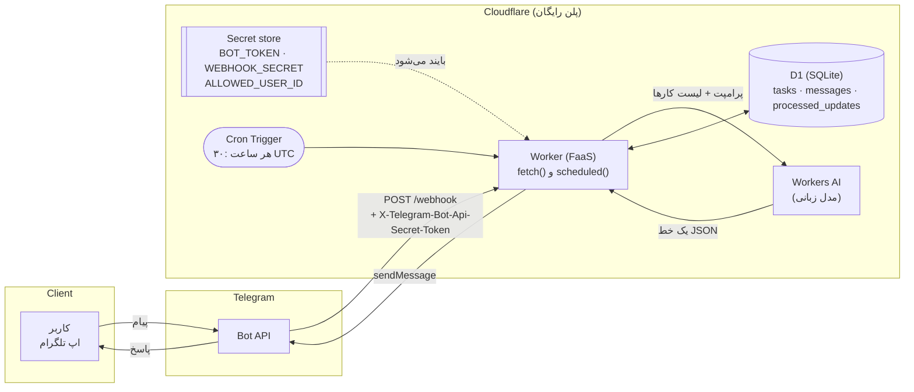
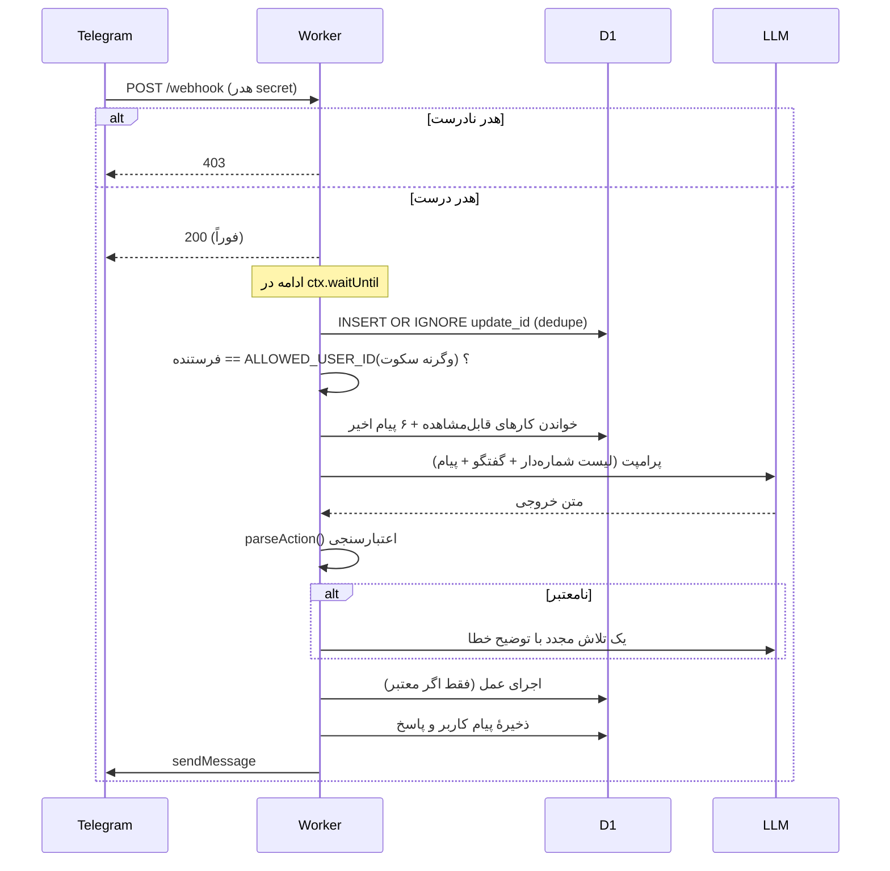

# معماری و توجیه تصمیم‌ها (فاز ۱)

این سند پاسخ فاز ۱ است: نمودار، و چهار پرسش «webhook یا polling؟»، «چرا FaaS؟»، «چرا رابطه‌ای (D1) و نه KV؟»، «state کجا زندگی می‌کند؟».
بعد از خواندن، دیاگرام را با دست خودت هم بکش و با زبان خودت توضیح بده؛ در دفاع همین از تو پرسیده می‌شود.

## ۱. نمودار



### توالی یک پیام



## ۲. تصمیم‌ها

### webhook یا polling؟ → **webhook**

- در polling باید یک فرایند همیشه‌روشن مدام `getUpdates` بزند. Worker نمی‌تواند چنین حلقهٔ بلندمدتی داشته باشد (محدودیت CPU/زمان)، و داشتن سرور برای آن دقیقاً چیزی است که پروژه ممنوع کرده.
- با webhook تلگرام خودش وقتی پیامی آمد ما را صدا می‌زند: کد فقط روی رویداد اجرا می‌شود. این همان الگوی FaaS است.
- هزینه: در polling حتی با بازهٔ ۵ ثانیه ≈ ۱۷٬۰۰۰ درخواست در روز بی‌فایده؛ در webhook صفر درخواست بیکار.
- ریسک webhook: هر کسی می‌تواند به URL درخواست بزند ← با **secret token** در هدر و رد ۴۰۳ مهار می‌شود (R6).

### چرا FaaS (Cloudflare Workers) برای این بار کاری؟

- یک کاربر، چند ده پیام در روز: ترافیک **پراکنده و بیکار-غالب**. روشن نگه‌داشتن یک VM برای ۹۹٪ زمانِ بیکار هدر است؛ FaaS «scale to zero» است و فقط وقت اجرا حساب می‌شود.
- بدون مدیریت سیستم‌عامل، patch، restart، Docker.
- Worker چندکاره نیست و منتظر I/O (LLM، D1) است؛ زمان انتظار از **CPU time** حساب نمی‌شود، پس سقف ۱۰ms CPU پلن رایگان کافی است.
- معایب که باید بدانی: stateless است (state باید بیرون باشد)، cold start (در Workers بسیار کوچک)، محدودیت‌ها (جدول زیر)، وابستگی به پلتفرم (vendor lock-in).

### چرا D1 (رابطه‌ای) و نه KV؟

| نیاز ما | D1 | KV |
|---|---|---|
| لیست مرتب کارها با شماره‌ی موقعیت | `ORDER BY id` | باید همهٔ کلیدها را list و در کد مرتب کنیم |
| فیلتر «باز یا امروز تمام‌شده» و «حذف‌نشده» | یک `WHERE` | باید همه را بخوانیم و در کد فیلتر کنیم |
| تغییر چندمرحله‌ای اتمیک (batch) | `db.batch()` تراکنشی | ندارد |
| سازگاری | قوی | نهایی (eventually consistent): بعد از نوشتن ممکن است لحظاتی مقدار قدیمی بخوانیم، که برای «شیر رو خریدم ← چیه کارام؟» بد است |
| Idempotency (جلوگیری از پردازش تکراری) | `INSERT OR IGNORE` با کلید اصلی | race condition |
| تغییر ساختار در طول زمان | migration | بی‌ساختار |

KV برای cache و تنظیمات پرخوان مناسب است، نه برای داده‌ای که مدام ویرایش و پرس‌وجو می‌شود.

### state کجا زندگی می‌کند؟

| چیز | کجا | چرا |
|---|---|---|
| کارها | D1 `tasks` | ماندگار، از هر دستگاه، بعد از restart |
| حافظهٔ گفتگو | D1 `messages` (آخرین ~۲۰ ردیف، ۶ تا در پرامپت) | Worker بین درخواست‌ها حافظه ندارد |
| پیام‌های پردازش‌شده | D1 `processed_updates` | جلوگیری از دوبار اجرا |
| توکن‌ها و آیدی کاربر | **Secret store** | هرگز در کد/ریپو/لاگ |
| تنظیمات غیرمحرمانه (مدل، ساعت یادآور) | `[vars]` در `wrangler.toml` | قابل نمایش |
| داخل Worker | هیچ چیز | همه‌چیز stateless؛ هر نمونه می‌میرد یا کپی می‌شود |

## ۳. «امروز» به وقت تهران (فاز ۳)

Worker منطقهٔ زمانی ندارد (UTC). تعریف ما:

> **«امروز» = تاریخ تقویمی در `Asia/Tehran`**، محاسبه‌شده در کد با `Intl.DateTimeFormat`، ذخیره‌شده به‌صورت متن `YYYY-MM-DD` در ستون‌های `created_day` و `done_day`. زمان‌های دقیق (`created_at` …) همیشه UTC ISO هستند.

نتیجه‌ها:
- کارهای باز همیشه در لیست هستند؛ کارهای انجام‌شده فقط در **همان روز تهرانی** که تمام شده‌اند نمایش داده می‌شوند (روز بعد از لیست پنهان می‌شوند ولی در DB می‌مانند).
- مرز روز نیمه‌شب تهران است، نه ۰۰:۰۰ UTC (۰۳:۳۰ بامداد تهران). تست: `test/worker.test.mjs` («۲۰:۴۵ UTC = ۰۰:۱۵ تهران»).
- ایران از ۲۰۲۲ ساعت تابستانی ندارد، پس offset ثابت +۰۳:۳۰ است؛ `Intl` در صورت تغییر قانون هم خودش درست حساب می‌کند.
- یادآور: cron در دقیقهٔ ۳۰ هر ساعت UTC اجرا می‌شود (= سر ساعت تهران) و `tehranHour() === REMINDER_HOUR` را بررسی می‌کند.

## ۴. لایهٔ هوشمند (فاز ۴)

**قرارداد:** مدل باید دقیقاً یک خط JSON برگرداند:

```
{"action":"add","items":["..."]}          {"action":"done","target":3 | [1,2] | "all"}
{"action":"undone","target":...}          {"action":"del","target":...}
{"action":"list"}                         {"action":"chat","reply":"..."}
```

**چهار لایهٔ دفاع در برابر خروجی بد:**

1. **پرامپت:** لیست شماره‌دار فعلی، قواعد صریح («اگر نمی‌دانی کدام کار است، با `chat` بپرس»)، مثال‌ها.
2. **`parseAction()`:** استخراج اولین `{` تا آخرین `}` (تحمل code fence)، `JSON.parse`، بررسی `action` در مجموعهٔ ثابت، نوع/طول فیلدها، حداکثر ۱۰ مورد در یک `add`، شماره‌ها فقط عدد صحیح مثبت.
3. **یک تلاش مجدد** با شرح علت نامعتبر بودن. اگر باز هم نشد → `fallback` («متوجه نشدم»). **در این مسیر هیچ چیز در DB نوشته نمی‌شود.**
4. **بررسی محدوده در اجرا:** «شماره ۹» وقتی ۳ کار داریم، پیام دوستانه می‌گیرد؛ هیچ ردیفی تغییر نمی‌کند.

**موارد دشوار داوری:**

| ورودی | رفتار |
|---|---|
| «همه رو حذف کن» | `target:"all"` ← حذف نرم همه + گزارش تعداد |
| «شماره ۳ رو پاک کن» | `target:3`؛ اگر ۳ نبود ← پیام «توی لیست نیست» |
| «همین رو حذف کن» | مدل از گفتگوی اخیر حدس می‌زند؛ اگر مطمئن نیست `chat` و سؤال |
| جملهٔ مبهم | `chat` با سؤال توضیحی، بدون تغییر |
| خروجی غیر JSON | تلاش مجدد، سپس fallback امن |
| «دستورهای قبلی را نادیده بگیر…» | پیام کاربر **داده** است، نه دستور؛ و حتی در بدترین حالت فقط می‌تواند یکی از ۶ عمل مجاز را انتخاب کند |

**چرا حذف نرم؟** مدل ممکن است اشتباه کند. `deleted_at` یعنی ردیف می‌ماند و قابل بازیابی است؛ فقط از دید کاربر پنهان می‌شود.

**چرا دو شماره‌گذاری یکسان؟** شمارهٔ لیستی که کاربر می‌بیند، شمارهٔ لیستی است که به مدل داده می‌شود (هر دو از یک تابع `listTasks`).
محدودیت شناخته‌شده: اگر کاربر لیست قدیمی را ببیند و قبل از ارسال پیام، لیست تغییر کند (مثلاً از دستگاه دیگر)، شماره‌ها جابه‌جا می‌شوند.

## ۵. امنیت

- **secret webhook:** مقایسه با هش SHA-256 و حلقهٔ زمان‌ثابت (جلوگیری از timing attack)؛ نبودن secret در تنظیمات هم ← ۴۰۳.
- **لیست سفید:** فقط `ALLOWED_USER_ID`، فقط چت خصوصی؛ بقیه بی‌صدا، چون پاسخ‌دادن به غریبه‌ها آنها را به کاوش تشویق می‌کند. (HTTP همچنان ۲۰۰ است تا تلگرام دوباره نفرستد.)
- **secretها** فقط در Secret store؛ لاگ‌ها هیچ‌وقت URL فراخوانی تلگرام را نمی‌نویسند (توکن داخل URL است).
- **اندازهٔ ورودی:** ۱۰۰۰ نویسه؛ سقف ۱۰۰ کار؛ سقف طول کار ۲۰۰ نویسه.
- **خروجی:** بدون `parse_mode`، پس متن کاربر/مدل نمی‌تواند HTML/Markdown تزریق کند.

## ۶. چرا پیام تکراری نمی‌آید؟

اگر webhook با کدی غیر ۲xx یا دیر جواب بدهد، تلگرام همان update را دوباره می‌فرستد. دو دفاع داریم:
۱) بعد از تأیید secret **همیشه ۲۰۰ فوری** برمی‌گردانیم و کار اصلی را در `ctx.waitUntil` انجام می‌دهیم.
۲) `processed_updates` با `INSERT OR IGNORE`: اگر `update_id` قبلاً دیده شده باشد، دوباره اجرا نمی‌شود.

## ۷. محدودیت‌های پلن رایگان (از مستندات Cloudflare، ۹ آبان ۱۴۰۵ / ۳۱ اکتبر ۲۰۲۶)

| منبع | سقف رایگان | مصرف تقریبی ما (۱ کاربر، ۲۰ پیام در روز) |
|---|---|---|
| درخواست Worker | ۱۰۰٬۰۰۰ در روز | ≈ ۴۷ |
| CPU در هر فراخوانی | ۱۰ms (زمان انتظار I/O حساب نمی‌شود) | چند میلی‌ثانیه |
| subrequest خارجی در هر فراخوانی | ۵۰ | حداکثر ۳ (LLM ×۲ + تلگرام) |
| Cron Trigger | ۵ در هر حساب | ۱ |
| D1 خواندن ردیف | ۵ میلیون در روز | چند هزار |
| D1 نوشتن ردیف | ۱۰۰٬۰۰۰ در روز | ≈ ۱۲۰ |
| D1 فضا | ۵ گیگابایت کل | چند صد کیلوبایت |
| Workers AI | ۱۰٬۰۰۰ نیورون در روز | ≈ ۱۸۰ |

اگر D1 به سقف روزانه بخورد، پرس‌وجوها خطا می‌دهند تا نیمه‌شب UTC (از ۱ سپتامبر ۲۰۲۶ اجرایی شده). Workers AI هم بعد از سقف روزانه خطای ۴۲۹ می‌دهد؛ کد در این حالت پیام «الان نمی‌تونم…» می‌فرستد و چیزی نمی‌نویسد.

## ۸. پرسش‌های محتمل در دفاع

1. **چرا `ctx.waitUntil`؟** تا فوراً ۲۰۰ بدهیم و تلگرام دوباره نفرستد. محدودیت: تا حدود ۳۰ ثانیه بعد از پاسخ (طبق مستندات)؛ LLM ما بسیار سریع‌تر است.
2. **اگر LLM ۱۰ ثانیه کند باشد؟** CPU مصرف نمی‌شود؛ فقط زمان دیواری. برای OpenAI-compatible timeout ۲۰ ثانیه گذاشته‌ایم.
3. **چرا یک فایل؟** محدودیت درس؛ ولی توابع خالص (`parseAction`، `tehranDate`) export شده‌اند تا تست‌پذیر باشند.
4. **اگر دو پیام همزمان بیایند؟** برای یک کاربر نادر است. `batch` تراکنشی است؛ بدترین حالت شماره‌گذاری قدیمی است (محدودیت بخش ۴).
5. **چرا secret برای `ALLOWED_USER_ID`؟** محرمانه نیست؛ ولی نگه‌داری آن بیرون از کد باعث می‌شود ریپو عمومی شود بی‌آنکه هویت لو برود.
6. **چرا تلاش مجدد فقط یکی؟** هر تلاش نیورون خرج می‌کند و سقف روزانه کم است؛ دو تلاش تعادل خوبی است.
7. **چه چیزی در مقیاس ۱۰٬۰۰۰ کاربر می‌شکند؟** گزارش فاز ۶ (`REPORT.md`): ستون `user_id`، ثبت‌نام، صف برای LLM، محدودیت نرخ ارسال تلگرام، پلن پولی.
8. **چرا نه Python Worker / فریمورک؟** سادگی، حجم کم، و شرط پروژه.
9. **این کد را خودت نوشتی؟** صادقانه: با ابزار هوش مصنوعی ساخته شده (شرط درس)؛ تو باید بتوانی هر تابع را توضیح بدهی. `AI_WORKFLOW.md` را ببین.
